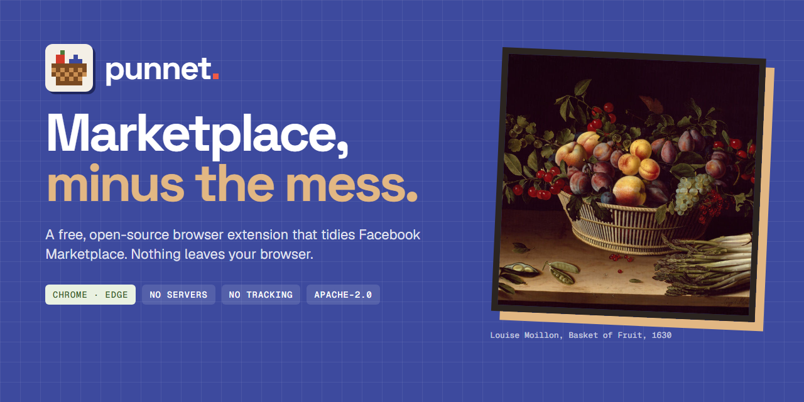
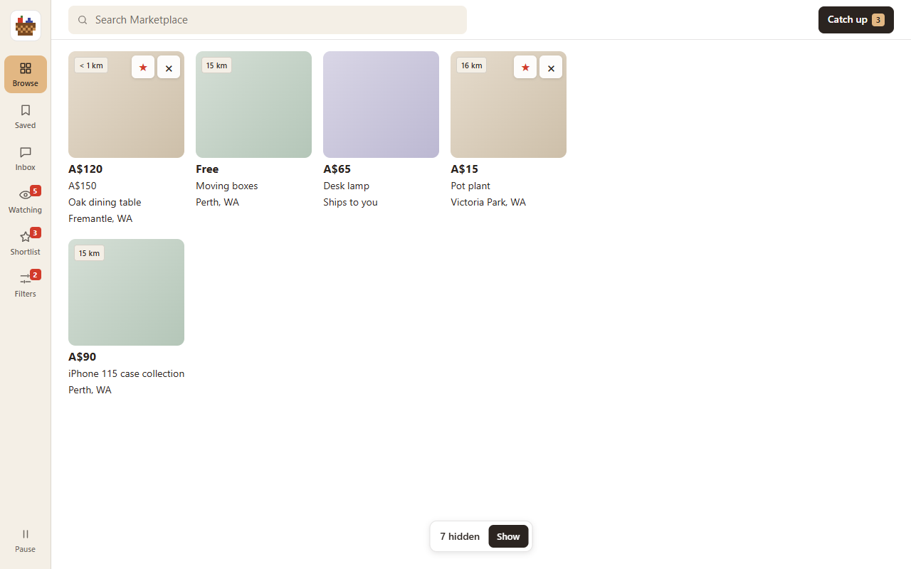
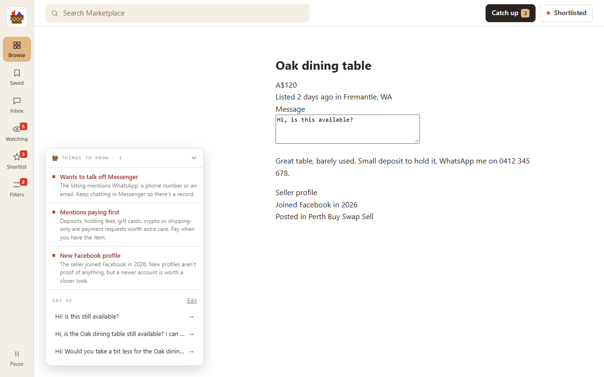
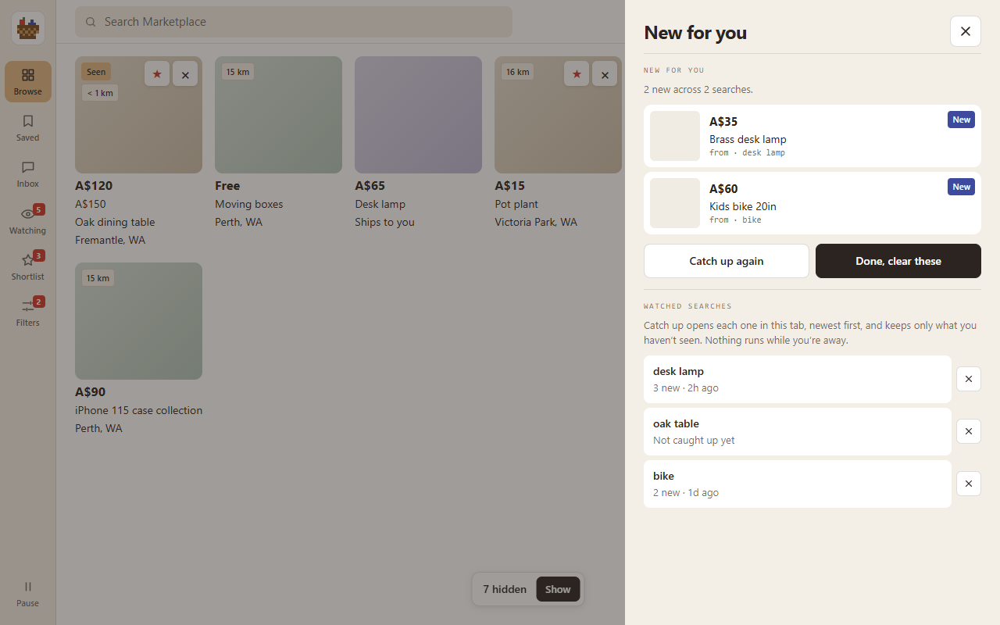
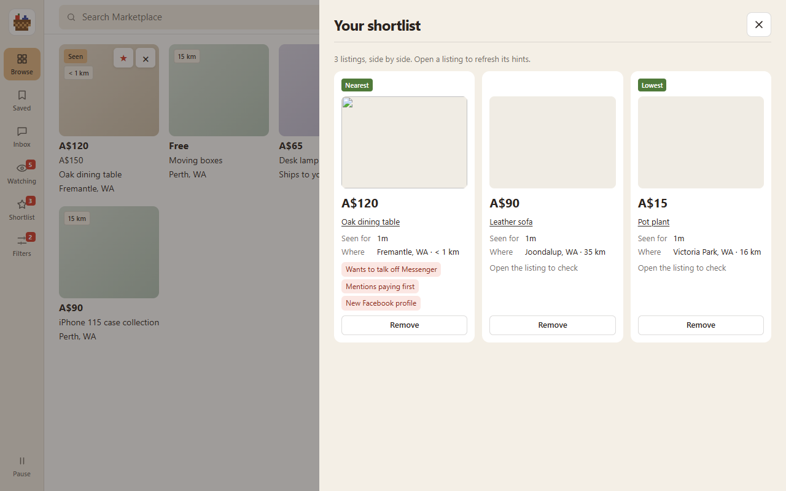

<p align="center">
  
</p>

<p align="center">
  <a href="https://punnet.dev"></a>
  <a href="#install"></a>
  <a href="docs/PRIVACY.md"></a>
  <a href="#develop"></a>
</p>

Marketplace is useful. Scrolling through sold posts, "wanted" ads and $1 placeholder prices is not. punnet tidies Marketplace while you browse, so the good listings are the ones you see.

It works with the Marketplace you already use: your own Facebook login, Facebook's own listing pages and messages. Nothing leaves your browser.

## What it does

| Find | Remember | Decide |
| --- | --- | --- |
| Opens straight into Marketplace, not the feed | Tags listings as new, seen or hidden | Star listings and compare them side by side |
| Hides sold, pending, wanted, swap and placeholder-price posts | Notices price drops and relisted items | Plain-English hints when you open a listing |
| Leaves out the words you choose | Catches up on up to eight saved searches, when you ask | Message starters that fill the box. You press Send |
| Approximate distance from your Australian suburb | Puts back anything you hid, any time | Keeps Facebook's own pages and messaging |

One switch in the toolbar pauses punnet, and Facebook looks exactly like Facebook again.

<p>
  
  
</p>
<p>
  
  
</p>

## Nothing leaves your browser

- **No servers.** There is no punnet backend. Your filters, shortlist and history are stored in `chrome.storage.local` on your device and nowhere else.
- **No account, no tracking.** Nothing to sign up for. No analytics, no ads, no remote code or fonts.
- **No cookies or passwords.** punnet doesn't ask for permission to read them.
- **Never sends a message.** Message starters only put your words in the box.
- **No background checking.** Catch up only opens your saved searches when you tap it, in your own visible tab.

punnet runs on Facebook's pages, so Facebook still sees what it always sees. It tidies Marketplace; it doesn't make Facebook private. The full detail is in the [privacy policy](docs/PRIVACY.md).

| Permission | Why |
| --- | --- |
| `storage` | Keep your filters, searches and shortlist on your device |
| `declarativeNetRequest` | Send the feed and other Facebook areas back to Marketplace |
| `https://*.facebook.com/*` | Add punnet's controls to Marketplace pages |

## Install

**Chrome Web Store:** coming soon.

**From this repo:**

1. Clone or download this repository.
2. Open `chrome://extensions` (or `edge://extensions`) and turn on **Developer mode**.
3. Choose **Load unpacked** and pick the `extension/` folder.
4. Pin punnet, then open Facebook Marketplace.

Needs Chrome or Edge 111 or later.

## Develop

Needs Node.js.

```bash
npm install
npm test            # unit and DOM tests
npm run test:e2e    # loads the unpacked extension against local fixtures
npm run pack        # builds dist/punnet-<version>.zip
```

`npm run build:rules` rebuilds the redirect rules, `npm run build:places` rebuilds the suburb table, and `npm run live-check` is a read-only check against the real Marketplace. To run the browser tests in Edge, set `MM_BROWSER=msedge`.

```text
extension/
├── manifest.json        Manifest V3
├── rules/               redirects back to Marketplace
├── src/
│   ├── background.js    default settings and the pause switch
│   ├── content/         the interface on Marketplace pages
│   ├── core/            filters, routes, memory, watched searches, shortlist
│   ├── data/            bundled Australian suburbs
│   └── popup/           toolbar popup
└── icons/
```

## Good to know

- **Facebook changes its pages.** When it does, filters may need an update. Issues are welcome.
- **Distance is approximate and Australia-only.** It compares suburb centres, not addresses.
- **Newest-first works on searches**, not on Facebook's recommended feed.
- **Hints are a second pair of eyes, not a verdict.** Always meet somewhere safe and check the item before you pay.

## Licence

[Apache-2.0](LICENSE). See [NOTICE](NOTICE) for attribution. Suburb data comes from [GeoNames](https://www.geonames.org/) under [CC BY 4.0](https://creativecommons.org/licenses/by/4.0/). The painting on the cover is Louise Moillon's *Still Life with a Basket of Fruit and a Bunch of Asparagus* (1630), a public-domain work from the Art Institute of Chicago.

punnet is an open-source brand from [primitive](https://primitiveai.com.au), made in Perth. It is not affiliated with, endorsed by or sponsored by Meta. Facebook and Marketplace are trademarks of Meta Platforms, Inc.
